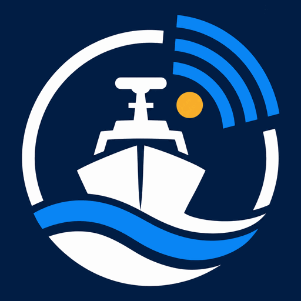

# DIAMBAR 2027



Démonstrateur de la plateforme **DIAMBAR 2027** : surveillance maritime du Sénégal par drones de surface (USV) construits localement et fusion des données AIS, VMS et satellites.

Projet porté par Papa Tahibou TALL dans le cadre du Prix spécial du Président de la République pour l'innovation technologique et industrielle à vocation militaire et paramilitaire.

> **Démonstrateur.** Toutes les données sont simulées. Les navires civils, numéros OMI et MMSI, licences et listes INN sont fictifs (préfixe `SIM`). Les moyens de l'État portent leurs noms, leurs positions et missions sont simulées. Les limites maritimes, aires marines protégées, câbles et installations sont des tracés **indicatifs**, non officiels.

## Lancer la démo

Aucune installation n'est nécessaire.

- **En ligne** : activer GitHub Pages (Settings, Pages, branche `main`, dossier racine), puis ouvrir l'adresse indiquée.
- **En local** : ouvrir `index.html` dans un navigateur récent (connexion Internet requise pour la bibliothèque de carte et les polices).
- **Un seul fichier** : `dist/diambar-2027.html` regroupe tout le code, les données et le logo (seules la bibliothèque Leaflet et les polices viennent d'Internet).

À l'ouverture, deux choix : suivre la **démo guidée** (les 16 cas commentés pas à pas) ou **explorer librement** (lecture, alertes, envoi des drones, décisions).

## Ce que montre la démonstration

Vingt-quatre heures dans la zone économique exclusive du Sénégal, du mercredi 14 octobre 2026 à 6 h au lendemain 6 h. La plateforme ne voit que ce que voient les capteurs : AIS côtier et satellite, balises VMS transmises par la DPSP, images Sentinel-1 et Sentinel-2, acquisitions radar commerciales, radars et caméras des drones et des patrouilleurs, signalements.

### Les 16 cas du scénario

| Heure | Cas | Ce que fait la plateforme |
|---|---|---|
| 08:06 | Dégazage repéré par satellite | Nappe de 25 km sur l'image Sentinel-1, remontée des traces AIS avec correction du courant, pollueur désigné, drone de la Gendarmerie, HASSMAR |
| 11:50 | Chalutage dans l'AMP de Kayar | Trois indices cumulés (bande des 6 milles, hors zone de licence, aire protégée), preuve en 32 minutes |
| 12:55 | Chalutier étranger sans licence | Navire absent du registre, drone de l'Armée de l'air, arraisonnement par le Niani |
| 13:47 | Identité AIS clonée | Deux émetteurs pour un même navire, la balise VMS désigne l'imposteur |
| 16:25 | Ancre sur les câbles sous-marins | Cargo immobile hors de la zone de mouillage, DIAMBAR-01 contourne la presqu'île et confirme |
| 18:28 | Pirogue de pêche disparue | Signalement du quai de Kayar, contact Sentinel-2 retrouvé, calcul de dérive, drone, vedette Lac Retba |
| 20:16 | Navire sans AIS au radar satellite | Frigorifique au nom masqué retrouvé à l'estime |
| 22:35 | Rassemblement et départ de pirogue | Rassemblement détecté par le modèle drones-satellite, DIAMBAR-02 au large, suivi du départ de nuit |
| 22:57 | Chalutier sombre devant Saint-Louis | AIS puis VMS coupés, DIAMBAR-03 filme le chalut dans la bande des 6 milles |
| 00:37 | Balise VMS déplacée | Positions VMS et AIS incompatibles, balise retrouvée sur une pirogue d'appui |
| 00:58 | Navire INN en approche du port | Numéro OMI inscrit sur une liste INN, accès au port refusé |
| 01:08 | Transbordement en pleine mer | Palangrier et frigorifique bord à bord, intervention du Walo |
| 02:56 | Intrusion sous la plateforme de Sangomar | Senneur dans la zone de sécurité de 500 m, exploitant et Marine alertés |
| 04:23 | Position AIS falsifiée et go-fast | Saut de position AIS, transfert observé par drone, point et heure d'arrivée du go-fast transmis à la Gendarmerie |
| 04:30 | Pirogue en détresse | Panne moteur de la pirogue suivie, 140 personnes recueillies par le Niani |
| 04:55 | Fausses alertes et apprentissage | Panne d'AIS et pirogue de pêche en règle, levées par drone, fiabilité des règles ajustée |

### Les briques de la plateforme

| Brique | Rôle |
|---|---|
| Fusion de données | Pistes alimentées par l'AIS, le VMS, les satellites et les radars ; corrélation par distance, taille et vitesse ; navigation à l'estime quand un navire se tait |
| Détection | 21 règles : AIS coupé, VMS silencieux, écart VMS/AIS, bande des 6 milles, zone de licence, aire marine protégée, pêche sans licence, arrêt prolongé au large, transbordement, liste INN, identité clonée, navire sans AIS, position falsifiée, go-fast, rassemblement, embarcation non identifiée, détresse, disparition signalée, zone de sécurité d'une plateforme, câbles sous-marins, nappe d'hydrocarbures |
| Score de risque | Indice le plus fort, plus 4 points par indice supplémentaire, pondéré par la fiabilité apprise de chaque règle |
| Envoi des moyens | Le moyen qui arrive le plus tôt part vérifier ; les drones de surface DIAMBAR sont préférés quand ils arrivent en moins de 2 heures, les drones aériens restent pour les urgences et les cibles rapides ; les routes des moyens de surface contournent la terre |
| Preuves | Image horodatée et géolocalisée prise par la caméra du moyen (visible le jour, infrarouge la nuit), observations, empreinte |
| Suites | Transmission à la DPSP, à la Marine nationale, à la Gendarmerie, à la HASSMAR, à l'exploitant d'une plateforme, refus d'accès au port, arraisonnement, sauvetage |
| Apprentissage | Chaque vérification met à jour la fiabilité de la règle ; les fausses alertes reculent dans le classement |
| Modèle drones-satellite | Volet de recherche : les images de drones servent de vérité terrain pour rendre les pirogues visibles sur les images satellites |

### Lire la carte

La carte reprend les codes d'une carte marine : teintes de profondeur et isobathes, trait de côte, graduations en degrés et minutes, échelle en milles nautiques. Les couleurs indiquent le statut, comme sur un écran de commandement : bleu pour les drones DIAMBAR, bleu marine pour les moyens de l'État, vert pour les navires identifiés en règle, jaune pour les contacts sans identité, rouge pour les navires sous alerte. Chaque navire est dessiné à sa forme réelle et orienté selon son cap.

Le mode **Vérité terrain** (menu Couches) révèle tous les navires, y compris ceux que les capteurs ne voient pas : c'est le mode formateur.

## Structure du code

```
index.html              Page principale
css/style.css           Styles (mode clair, couleurs du logo)
assets/                 Logo et icône
js/geo-data.js          Côtes, bathymétrie et zones maritimes indicatives (généré)
js/geo.js               Outils géographiques : milles, caps, masques, navigation en évitant la terre
js/data.js              Données de référence et scénario de 24 heures
js/sim.js               Simulation : navires (vérité terrain), capteurs, moyens
js/detect.js            Plateforme : fusion, règles, score, apprentissage, envoi des moyens, preuves
js/symbols.js           Silhouettes vues de dessus des navires, drones et avions
js/render.js            Carte marine et couche dynamique (Leaflet et canvas)
js/camera.js            Images des preuves et extraits satellites
js/ui.js                Interface : frise du temps, alertes, moyens, navires, journal, démo guidée
tools/build-geo.js      Génère js/geo-data.js à partir d'OpenStreetMap et de Natural Earth
tools/build-single.js   Assemble dist/diambar-2027.html
tools/test-scenario.js  Rejoue les 24 heures sans interface et liste les alertes
vendor/leaflet/         Feuille de style et licence de Leaflet
```

Le code est en JavaScript, sans dépendance de compilation.

```bash
node tools/test-scenario.js            # rejoue le scénario de référence et liste les alertes
node tools/test-scenario.js --manuel   # sans les décisions de l'opérateur virtuel
node tools/test-scenario.js --terre    # signale tout navire ou moyen qui passerait sur la terre
node tools/build-single.js             # fichier unique dans dist/
```

## Passer aux données réelles

| Source | Accès envisagé |
|---|---|
| AIS | Flux AIS terrestre et satellite (fournisseur commercial ou récepteurs côtiers sénégalais) |
| VMS | Partenariat avec la Direction de la Protection et de la Surveillance des Pêches |
| Licences | Registre des navires autorisés publié par le ministère des Pêches |
| Listes INN | Listes publiques des organisations régionales de gestion des pêches (ICCAT, CTOI...) |
| Imagerie | Copernicus Sentinel-1 et Sentinel-2 (gratuit), acquisitions commerciales sur commande |
| Détections de navires | API de Global Fishing Watch (gratuite pour les usages non commerciaux) |
| Limites maritimes | Limites officielles (SHOM, Marine Regions) à la place des tracés indicatifs |

## Limites du démonstrateur

- Les capteurs, probabilités de détection, performances des moyens et du modèle drones-satellite sont des hypothèses d'illustration, pas des mesures.
- La zone économique exclusive, la mer territoriale, la bande des 6 milles et la zone commune avec la Guinée-Bissau sont calculées géométriquement pour la démonstration.
- Aucune donnée réelle ni sensible n'est utilisée.

## Crédits

- Trait de côte et mer territoriale : © contributeurs [OpenStreetMap](https://www.openstreetmap.org/copyright) (ODbL), via geo-maps.
- Bathymétrie, fleuves et frontières : [Natural Earth](https://www.naturalearthdata.com/) (domaine public).
- Carte interactive : [Leaflet](https://leafletjs.com/) (licence BSD-2, voir `vendor/leaflet/LICENSE`).
- Polices : Barlow et Barlow Condensed (Google Fonts, licence OFL).
